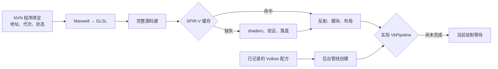

# 2026-10-30：着色器编译架构审查

用户要求重点检查编译架构，参考 d2r-mobile 及其分支，并补充 Eden 等项目，目标是减少游玩时编译卡顿。
本轮完成 Git/源码审查与正式 CPU 路径测量，没有修改运行时、构建/安装 APK 或操作手机。
真实 2× / 60 FPS、转视角和首次落水后持久 20 FPS 的目标/问题继续保留。

**首要差距是准备结果没有完整进入运行时的首次使用路径。**
我们有 SPIR-V 缓存、请求映射、后台准备和实际 Vulkan 管线预热，但首次遇到程序仍生成 GLSL，
才能确定 SPIR-V 键；预热使用过的模块/反射也会在运行时重新读取和创建。
此外，全新缓存缺少实际 Vulkan 管线种子，两个后台池和运行时编译池缺少统一预算。
“编译在线程里”仍可能让当前 draw/dispatch 等待，不能等同于消除停顿。

## 固定参考版本与实际机制

| 项目 | Git 基点 | 核对结果 |
| --- | --- | --- |
| [D2R Mobile main](https://github.com/jhaizhou-ops/d2r-mobile/commit/c7ff2f8570fd9bc43cd04142e1af4d3b4a3a08be) | c7ff2f8570fd9bc43cd04142e1af4d3b4a3a08be | 电脑将 Maxwell 经 Ryujinx 翻译器导出 SPIR-V，再打包 XGS：SPIR-V、绑定/输入元数据、c1 常量；Android 按 shader key 直接加载，另做必要的驱动改写和模块创建 |
| [android-warm-seed-pack](https://github.com/jhaizhou-ops/d2r-mobile/commit/9625ef3b50321c30beb7028cef972e0d4080b2d6) | 9625ef3b50321c30beb7028cef972e0d4080b2d6 | 补充打包时的 --warm-seed、解析、shader key 匹配与导入指纹；引擎早有 seed 读取，但 main 的打包器没有该入口，不能把分支功能算成 main 已交付 |
| [android-pipe-guard](https://github.com/jhaizhou-ops/d2r-mobile/commit/d4275cd9ecb4ad28ca12f44f2652a84b2b78d2f5) | d4275cd9ecb4ad28ca12f44f2652a84b2b78d2f5 | 处理驱动编译失败/崩溃后的重复启动，含跳过相关 draw/dispatch；属于故障策略，不是本项目可直接采用的无损提速方案 |
| [Eden](https://git.eden-emu.dev/eden-emu/eden/commit/035f4611cb8f369d11e97651aff1988e60e8a120) | 035f4611cb8f369d11e97651aff1988e60e8a120 | 序列化完整 pipeline key 和 shader environment；启动从环境重建 IR/SPIR-V/实际管线，采用每任务 ShaderPools、后台线程位置、可取消进度与单独缓存写入线程 |

D2R 的可借鉴细节：

- `dm/gfx/tools/dmsh_vk.py`、`pack_game_shaders.py`：提前准备可直接装载的 SPIR-V 和接口元数据。
- `xbg_game.cpp::load_shader/load_module`：预热后的改写 SPIR-V 可以由运行时领用；shader module、布局和 render pass 在预热线程之间复用。
- `warm::start`：后台 worker 数为 min(3, max(1, hardware_concurrency/3))，8 核时为 2，不是占满全部核心。
- `warm::seed`：首次没有设备记录时读取实际管线状态 seed；它是管线配方，不是可跨驱动复制的机器码。
- 所谓加载画面等待 15 秒的逻辑需要核对平台：当前 Android `nvn_vk.c::mtl_warm_wait` 是返回 0 的 stub，
  不能仅凭通用/Metal 注释声称 Android 已有这道门禁。

Eden 的 `vk_pipeline_cache.cpp::LoadDiskResources` 将文件环境按任务持有，调用者通过进度和 WaitForRequests 等待准备；
每个任务有 ShaderPools，Android worker 数受设置和 online-1 限制，坏并行驱动降为 1。
它的异步 BuiltPipeline 路径会对部分 draw 返回空管线；这种跳绘制策略不用于当前 TOTK 正确性要求。
本项目已有代码写入/重绑定代次失效和重启排空，不能照搬其页保护或简单地址缓存来替代。

MacNativeGames/Windows 的共享清单、预热索引与 Metal archive 审查仍见 [上轮记录](UPSTREAM-PERFORMANCE-20261030.md)；
其管线字节布局和设备产物不能直接作为 Adreno Vulkan 管线。
本轮没有导入上游代码，参考 checkout、分支和原始测量保存在忽略目录 .work/shader-architecture-20261030/。

## 我们现在的首次使用路径

1. `get_program` 的地址/代次表避免相同状态重复工作，但第一次仍调用 `translate_program`。
   `compile_program` 从 GLSL 算 key 后加载 SPIR-V，缓存命中不免除前面的 GLSL 生成。
   warm 的 RequestCache 只存原始输入+ShaderKey → source key/stage/VS outputs，没有完整 ShaderInfo，
   目前由预热使用，运行时不能仅凭这些字段跳过译码。
2. 图形译码在一个专用线程；计算 `compute_program` 仍在请求线程同步译码。
   两者和后台准备共享 translate_lock；RSC2 的静态缓冲环及全局配置证明不能直接删锁或增加译码线程。
3. 准备池默认 hardware_concurrency，实际管线预热默认 online cores（最多 64），Android 运行时池默认最多 4。
   8 核条件下上限可为 8+8+4；低优先级已有设置，但 CPU、内存和驱动内部编译锁的竞争并未统一控制。
4. `warm_pipeline_from_cache` 每个配方重新读/解压、反射并创建 shader modules，创建管线后释放 modules；
   同一 shader 出现在多个配方时重复这些工作。运行时仍另外创建自己的模块/布局。
5. `vk_pipeline_warm_start` 只从本设备已有记录启动。新安装已有 SPIR-V 清单不等于已有实际 VkPipeline。
   `VkPipelineCache` 是驱动缓存，也不保证每个未知管线在第一次调用 create API 时零成本。
6. `SHADER_BUILD_ID` 包含整个 exec.c、pipeline_warm 等文件。
   描述符、录制 worker 或清除改动也会让准备收据、RequestCache 路径和管线配方身份失效，即使 GLSL/编译器没变。
   精确源码 SPIR-V 的稳定 namespace 已分离，不能误说所有 SPIR-V 随 APK 重建丢失。
7. `stat_compiles` 同时统计程序/管线构建，`wait_built` 汇总等待；它们不是 shaderc 编译次数和纯编译时间，
   而且计算的同步译码发生在这项等待计时之前。后续事件需分别记录队列、译码、缓存、反射/模块、驱动创建。

## 正式本机路径测量

新增 [benchmark_shader_firstuse.sh](../tools/benchmark_shader_firstuse.sh) 调用正式目录、译码器、缓存加载、反射和编译组件：

    distrobox enter dev
    source android/dev_env.sh
    bash tools/benchmark_shader_firstuse.sh .work/totk-port/game/romfs.bin .work/firstuse-probe

读取自有 1.4.3 中各阶段代码段最大的输入；每项首次准备后，严格只读加载 5 次，不运行时编译。
输出 already_cached 区分再次运行的命中。输入只读，生成的 SPIR-V 仅进入指定隔离目录，不触碰玩家缓存。
固定 host GLSL/FP32/32-bit/GMap/structured/native-half/minmax/gather8 配置，不代表手机当前实际驱动或内存路径。

正式入口首次在独立目录测得：

| 输入 | 指令 / GLSL 字节 | 首次准备总 ms | 缓存命中前仍需译码 ms | 缓存加载 ms | 反射 ms |
| --- | ---: | ---: | ---: | ---: | ---: |
| VS record 27224 | 2,534 / 200,867 | 327.45 | 4.21 | 0.84 | 0.09 |
| FS record 11780 | 3,894 / 221,584 | 247.34 | 5.62 | 0.98 | 0.13 |
| CS record 23422 | 2,101 / 218,769 | 348.04 | 5.03 | 1.13 | 0.16 |

这是主机 CPU、大型静态输入和热文件缓存的范围；首次准备包含编译/验证/保存，缓存计时包含源码 key 与内容校验，
尚未测 VkShaderModule、VkPipeline 创建或队列等待。该轮模块为 standalone，不能把数字当作所有字典变体的代价。
不能把这些时间换算成手机 FPS，也不能据 3 个代表输入声称所有场景覆盖或预计全部收益。

历史证据也要分开：slot_1 首轮确实出现两份缺失计算源码的 shader-runtime compiling，后续 257 默认计算输入已补入；
另一些旧启动虽没有运行时编译消息，仍累计数秒首次使用等待。它们是不同情况，首次落水路线的根因仍未复现。

## 已明确的落地顺序与验收

**1. 准备包直读进入运行时。** 复用现有 catalog/RequestCache 的原始全 SHA-256、完整 ShaderKey 和 profile，
增加足够的 ShaderInfo/资源接口元数据与精确 SPIR-V source key；命中后直接创建模块/管线，绕过 GLSL 生成。
D2R 的 control 前 16 hex key 和固定 facts 不能原样替代 TOTK 的代码、常量、代次、状态和接口变体。
元数据必须带版本/大小界限/内容摘要，核对 stage、binding、类型与输出；损坏/缺失/不支持配置走真实译码和原编译回退。
运行时诊断源码替换、源码导出与 instrumentation 需走正式源码路径。
不先恢复全版本百万级穷举；先覆盖最近实际状态、257 默认计算输入和匹配共享清单。

**2. 有界复用已验证的准备结果，统一前后台编译预算。** 以 source key、实际设备与接口配置标识 SPIR-V/反射/modules，
有界保留并减少每条配方重复加载；引用保护 BUILDING、TAKEN 和重启回收，不能原地改变在途对象。
一个预算协调 shaderc 和驱动管线任务，前台需要的 key 提升优先级，后台可取消并保留已完成记录。
加载阶段和游玩阶段采用不同并发预算；不凭核心数固定开满，不强制异步跳 draw。
并发验收覆盖同 key 仅一次工作、前台优先、取消/错误/无 worker 回退、锁顺序、对象寿命和重启，追加 ASan/UBSan/TSAN 与真实 GPU 等价。

**3. 补实际 Vulkan 管线 seed，明确加载门禁。** 对本版本自己的完整程序/接口/固定状态生成可解析配方，
按实际 Vulkan features、格式与 limits 过滤，在本驱动重新创建管线；不复制其他设备 driver cache。
严格区分“SPIR-V 已准备”“管线已创建”“运行时领用成功”。已有部分/失败不能伪造完整准备标志，
在实际加载阶段处理等待，继续保留缺失状态的正常绘制等待和编译回退。

**4. 拆分身份，避免无关改动重做全部准备。** 将实际译码配置/键生成等从 exec.c 提取到明确的正式模块，
再分别计算译码/准备身份、SPIR-V 编译 namespace、pipeline recipe ABI 和设备身份。
不能直接删掉 exec.c 的哈希；那会遗漏当前仍在该文件里的配置和语义。
验收须证明无关渲染改动保留准确映射、语义/接口/API/精度变化失效、旧记录不伪装成新配置完成证明。

以上为本轮审查后的具体实施范围，运行时改造尚未实施。本轮提交仅包含审查记录和可复跑 CPU 分阶段测量入口。
手机操作禁用持续；后续实现先本地正反例与 GPU 验证，恢复手机授权后再检查相同路线冷热缓存、首次/重复停顿和真实 2×60。
