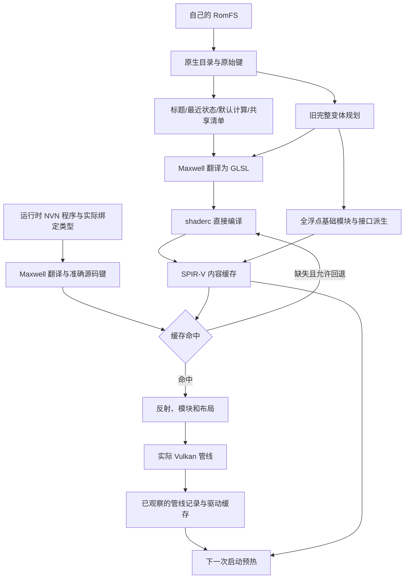

# 着色器链路审查（2026-10-29）

本次按用户要求审查输入目录、Maxwell 翻译、直接/派生 SPIR-V、持久缓存、标题/后台准备、
运行时程序/管线缓存及启动/重启接入。结论是：**当前均衡准备链路可以通过所列集成检查，
但不能宣称全游戏已经完全静态化；旧完整准备门禁还有实质缺口。**
后续已修复本页记录的完整准备门禁、只读输入和重启回收问题，见 [收尾记录](PROJECT-CLOSEOUT.md)。
以下保留首次审查时的复现与验证边界。

本次修复五类问题，保留现有功能默认值，没有恢复百万级全变体准备，也没有操作手机应用。
提交/推送时从共有文件中剥离仍在实验的 shared-alias/async-copy 改动，保留在原工作区；
着色器功能及共用资源失效通知独立交付。下表是审查时的混合工作区证据，分离后另验证实际提交树。

## 参考版本

- 直接参考 [MacNativeGames `4227378207c7a8dd973d0de05642eeda0d9ca0b4`](https://github.com/ly05010419/MacNativeGames/tree/4227378207c7a8dd973d0de05642eeda0d9ca0b4)，
  在本机参考仓库 fetch 后读取，未切换本项目或覆盖现有 vendored 文件。
- 本项目 vendored 解析器、清单与 seed 工具仍固定在
  [`f024ef04c707c4b4bb5b6328bfc55ae89642af40`](https://github.com/ly05010419/MacNativeGames/tree/f024ef04c707c4b4bb5b6328bfc55ae89642af40)，
  来源见 `third_party/macnativegames/UPSTREAM.json`。该提交到参考 HEAD 的两个 Python 解析/准备脚本无差异。
- 重点对照 `games/totk/scripts/prepare_shader_seed.py` 的 `TranslationCache`，以及
  `games/totk/third_party/d2r_gfx/gfx/nvn/totk_shader_rt.m` 的完整原始键、缓存选择和缺失回退。
  原始身份是 **控制段＋完整 NVN 代码区**；计算入口前的字节仍属于原始身份。
- 最新上游的 iOS 打包期 Metal 管线归档依赖 Apple 工具和设备目标，不能直接当 Android Vulkan 管线使用。
  上游 `deps_match` 忽略部分顶点/输出类型，是因为 Metal 管线阶段会重新声明类型；本项目 Vulkan 路径必须保留它们。

## 实际链路



“已准备 SPIR-V”“无需再次 Maxwell 翻译”“已有 Vulkan pipeline”是三个不同状态。
当前运行时仍要翻译首次遇到的 NVN 程序以获取源码键和资源元数据；单项请求映射主要用于提前准备的续用。
SPIR-V 命中后仍可能有反射、模块、布局和驱动管线创建工作。

## 已修复

### 1. 程序/管线查找表装满后无法返回（P1）

`exec.c` 原有 4096 项程序表、8192 项管线表都使用“找到空槽为止”的开放寻址，未扩容或检测装满。
不同场景逐步积累足够多的组合后，下一个请求会一直探测，与 SPIR-V 是否已提前准备无关。
对原程序查找函数的 5000 个合成请求复现了超时，已终止该独立探针。

现在两者共用 [shader_object_cache.h](../runtime/nvn/vulkan/shader_object_cache.h)，在达到半容量时扩容，
保留对象地址与原所有权；分配失败明确报告。测试覆盖 5000 个程序和 10000 个管线索引、桶冲突、重复命中和清空。
这修复查找不终止，不是增加新的管线预测或帧率优化。

### 2. 重启遗漏最后一次程序缓存（P1）

`vk_exec_reset` 原先清空程序表，却没有清空 `get_program` 的函数内静态快捷缓存。
重启后第一个请求若复用相同对象/代码地址和类型状态，会直接返回上一轮程序，绕过已清空的表。
原函数探针得到“reset 前后同一程序，翻译次数仍为 1”。

现在快捷缓存属于模块级状态，由 `program_cache_reset` 与主表一起清空。
[test_shader_program_cache.py](../tools/test_shader_program_cache.py) 执行正式查找/复位实现，确认重启后重新建立程序。
原有 Prog/Pipe 对象的保留策略没有在本次改成销毁策略，见后面的长期生命周期限制。

### 3. 目录去重遗漏计算程序前缀（P2）

`shader_archive::nvn` 已保存 `code_prefix`，但 `Catalog::intern` 只以翻译用的 `binary + control` 去重。
两个仅前缀不同的计算输入有不同上游 SHA-256，却被合并为一个目录记录，可能使某个共享清单键无法选中。
合成探针明确复现“原始键不同，目录 ID 均为 0”。

现在目录与平面审计共用完整 `input_identity`，翻译器仍只接收原有入口之后的字节。
增加仅前缀不同及完全重复输入的回归。当前真实 RomFS 仍为 28,634 个输入，
**本次没有发现当前语料因这个问题实际减少记录**，不能将它解释为此前全部统计差异的根因。

### 4. 独立手机准备工具可混用旧编译插件（P2）

`build_shader_phone_warm.sh` 原先按当前源码计算缓存身份，却固定从 `app/build/outputs/apk/debug/app-debug.apk`
复制 `libshaderprepare.so` 和依赖。修改编译器后只构建 Release 或未重建 Debug，可能把旧实现的输出写入新身份目录。

工具现在从当前源码和固定 NDK/依赖直接交叉构建插件，同时复制参与缓存身份计算的那份 shaderc。
不再需要任意 Debug APK。这是独立工具的配套问题，不是声称此前所有 APK 内插件都已混用。

### 5. 内置着色器命中仍依赖编译器（P2）

`vk_shaders_init` 原先无条件打开插件，然后才查询 36 个内置模块。
即使 SPIR-V 全部可用，缺少/无法加载编译插件仍使缓存启动失败。
现在先验证缓存，确有缺失才开始编译会话。回归先准备全部内置模块，再指向不存在的编译器目录重新初始化，
确认成功且没有增加编译会话。

## 首次审查时的未完成项（后续状态见收尾记录）

### 旧完整准备的 ready 不是缓存完整性证明（P1）

[shader_prepare.cpp](../runtime/nvn/vulkan/shader_prepare.cpp) 的 `vk_shader_game_ready` 仅比较
`game/.shaders-ready` 中的构建、文件 stat 和 profile 身份，没有保存并核验完整模块清单。
探针在 **整个 cache 目录不存在** 时写入符合当前身份的标记，门禁仍返回 true。
实际运行到缺失模块时严格加载器仍会失败，并不会把它当有效 SPIR-V 绘制，但启动门禁提前给出的结论过强。

此外旧完整路径仍向游戏目录写 `shader-prepare.log` 和 `.shaders-ready`；只读游戏输入会使准备失败。
均衡路径的元数据已迁入应用缓存，这两条路径的行为还没有统一。

这次没有用“检查目录存在”或抽样检查伪装成完整修复，也没有在 UI 每次检查时同步扫描数十万文件。
后续应为完整路径保存准确模块清单，在独立、可取消、有进度的检查阶段验证模块/字典依赖，
把 UI 的“有准备记录”与“本次完整检查通过”分开，并迁移到应用可写目录。
修复前不能据 `.shaders-ready` 宣称可以在无缓存或损坏缓存下启动。

### 静态覆盖和生命周期的边界

- 旧完整计划基于资源中已知的类型/阶段配对和保守枚举，不是全部运行时状态的形式化证明。
  当前默认标题/后台清单本来就不是穷举，运行时编译回退应保留。旧缓存可读不等于当前源码键命中。
- 整库准备直接配置翻译器全局状态，当前正式调用发生在游戏启动前；不能把该入口当成可与运行时翻译并行的后台 API。
  均衡后台路径已有共用翻译锁和 profile 变化检查。本次没有将整库 API 改造成运行中服务。
- 运行时程序仍依赖 guest 代码地址及绑定状态索引；同一次启动中代码地址复用/改写的完整失效协议还需专项验证。
  本次修复重启快捷缓存，不等于证明任意代码内存改写都能自动重建。
- 旧重启策略刻意保留 Prog/Pipe 对象以避免指针被新缓存键复用；长期反复重启的资源回收仍需处理。
  本次扩容保证查找终止，不承诺这些对象的显存/内存总量已经有界。
- 未重新做全冷手机、跨区域路线、全部着色器 GPU 数值或画面验收。没有据本次本机检查宣称卡顿消除或 FPS 提升。

## 验证证据

构建、生成与测试均在 `dev`。完整日志/私有输入衍生物留在 `.work/shader-chain-review-20261029/`，不进入 Git。

| 检查 | 结果 / 准确范围 |
| --- | --- |
| 目录与关联 | 真实 28,634 个输入全部保留，物料选择/程序配对和坏输入拒绝通过；新增前缀去重用例通过 |
| 全目录 FP32 翻译 | 14,760 VS、13,617 FS、257 CS，0 失败；没有将此称为全变体 SPIR-V/GPU 验证 |
| 标题/后台 | 875 个标题请求、734 个唯一模块，严格关闭编译入口后加载通过；取消、续用、profile 变化、只读输入、缺失模块回退通过 |
| 静态接口派生 | 72 个合成组合的派生/直接模块归一化 IR 一致，覆盖 Vulkan 1.1/1.3 和两种 shaderc 优化模式 |
| 既有真实接口组合样本 | 2,483 个组合，2,339 个唯一源码、153 个基础模块；派生/直接输出通过 SPIR-V、接口和保留运算检查，非逐字节或游戏 GPU 数值等价证明 |
| 缓存与插件 | 审核兼容目录、字典依赖、损坏/写入失败、运行时回退、36 个内置模块纯缓存启动通过；稳定缓存 ID 不变 |
| 线程/管线 | 首次等待、翻译到编译交接、失败唤醒、重启排空、预热取消/产物所有权通过 |
| Vulkan GPU | RADV 780M 上 352 个预热后图形/计算数值检查通过，覆盖传统/动态渲染和 EDS 分支；验证层 0 消息 |
| 容量/重启 | 正式程序查找与共用表检查覆盖 5000 个程序和 10000 个管线索引，ASan/UBSan 通过 |
| Android | Debug/dev 和 Release/8 Elite/perftest 构建；独立手机原生工具交叉构建；未安装手机或重建游戏库 |

核心日志：`catalog.log`、`library-fp32.json`、`background.log`、`interfaces.log`、`static-samples/comparison.json`、
`dictionaries.log`、`runtime.log`、`compat.log`、`pipeline.log`、`pipeline-gpu.log`、`program-cache-final.log`。
未修复完整门禁的复现见 `strict-marker-before.log`；最初缓存问题见 `catalog-prefix-before.log`、`program-cache-before.log`。

常用复核入口：

```bash
# dev 内，项目根目录
source android/dev_env.sh
"$PYTHON" tools/test_shader_program_cache.py
bash tools/test_shader_dictionaries.sh
bash tools/test_shader_warm_background.sh .work/shader-background-review .work/totk-port/game/romfs.bin
bash tools/test_pipeline_warm.sh
bash tools/test_vk_pipeline_warm.sh
```
